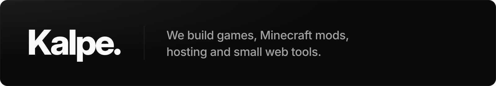

<a href="https://kalpe.games">
  <picture>
    <source media="(prefers-color-scheme: dark)" srcset="./assets/banner-dark.svg">
    <source media="(prefers-color-scheme: light)" srcset="./assets/banner-light.svg">
    
  </picture>
</a>

 

We're a small team making games, Minecraft mods and the services around them. We run [Sylant](https://sylant.net) for hosting, [ServerList](https://serverlist.cc) and [DonutMarket](https://donutmarket.cc) for Minecraft data, and publish our mods for free on [Modrinth](https://modrinth.com/user/Kalpe).

Our open-source mods and tools live here. Issues and pull requests are welcome.

[kalpe.games](https://kalpe.games) &nbsp;·&nbsp; [Discord](https://discord.gg/ST54KAbcCA) &nbsp;·&nbsp; [X](https://x.com/kalpegames) &nbsp;·&nbsp; [support@kalpe.games](mailto:support@kalpe.games)
